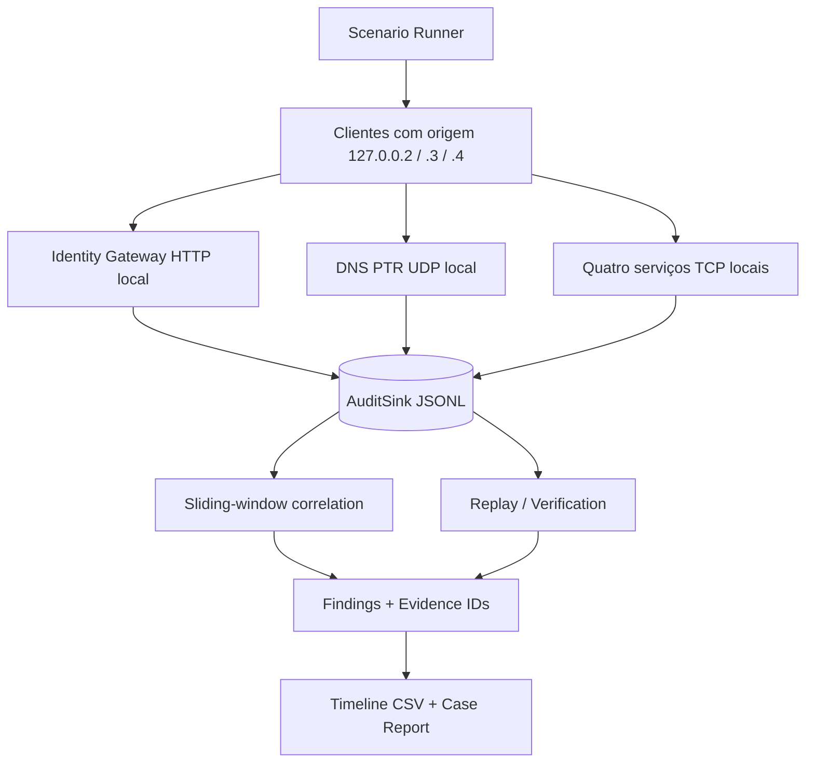

# Identity & Network Correlation Lab

**SOC Detection Engineering | Authentication Analytics | DNS PTR | Network Discovery | Evidence-Based Triage**


> **Objetivo:** investigar como autenticações negadas distribuídas entre identidades, consultas DNS reversas e conexões TCP podem formar um sinal correlacionado, sem presumir comprometimento a partir de tráfego ou autenticações isoladas.
>
> **Origem das evidências:** as transações são executadas contra serviços de laboratório que escutam exclusivamente em `127.0.0.1`. Os logs são emitidos **pelos próprios serviços durante as requisições reais no loopback**, não montados manualmente em CSV. As contas e os serviços são exclusivamente de laboratório. O trabalho não contém dados de clientes.

## Resultado da execução validada

| Verificação | Resultado observado |
| --- | ---: |
| Eventos de auditoria gerados pelos serviços | **31** |
| Origens de teste diferenciadas | **3** |
| Sinais elementares detectados | **3** |
| Correlação multissinal | **1** |
| Controles negativos que não acionaram password spray | **2** |
| Testes automatizados executados | **36 / 36 aprovados** |
| Autenticações de sucesso atribuídas à origem investigada | **0** |

O cenário contém 8 falhas em 8 identidades a partir da mesma origem, 7 consultas PTR distintas e 4 conexões TCP concluídas para serviços locais. A ferramenta registra **padrões observados**, não um diagnóstico de intrusão confirmado.

## Arquitetura



Todos os listeners escutam somente em `127.0.0.1`, em portas efêmeras. Os clientes usam aliases de origem `127.0.0.2`, `.3` e `.4` no Linux/WSL2. **Não existe parâmetro para indicar IP ou domínio externo.**

## Executar

Requisitos: **Linux ou WSL2**, Python **3.10+**. Nenhuma dependência Python externa; Docker, SIEM e produtos comerciais não são necessários.

```bash
git clone https://github.com/Liragbr/identity-network-correlation-lab.git
cd identity-network-correlation-lab
export PYTHONPATH=src
python3 -m soclab run --output artifacts
```

O programa abre serviços locais temporários, executa os cenários, desliga os serviços e grava:

```text
artifacts/
├── events.jsonl          # registros emitidos pelos servidores locais
├── findings.json         # detecções, métricas e evidências por evento
├── timeline.csv          # sequência cronológica de todos os eventos
└── case-report.md        # avaliação, limitações e recomendações
```

Para verificar a correlação sobre os mesmos eventos, sem executar o cenário novamente:

```bash
python3 -m soclab verify --events artifacts/events.jsonl --output artifacts/replay
python3 -m unittest discover -s tests -v
```

**Sem Linux/WSL2 disponível?** É possível inspecionar a amostra gerada em `examples/` e testar apenas a correlação:

```bash
export PYTHONPATH=src
python3 -m soclab verify --events examples/events.jsonl --output artifacts/offline
```

## O que o mecanismo de detecção verifica

| Hipótese / regra | Janela | Limiar de laboratório | Evidência |
| --- | --- | --- | --- |
| Password spray pattern (`T1110.003`) | 120 s | >= 6 principais distintos com autenticação negada por origem | Respostas do gateway de autenticação |
| Remote system discovery (`T1018`) | 120 s | >= 5 nomes PTR distintos consultados por origem | Datagramas DNS enviados ao responder local |
| Network service discovery (`T1046`) | 120 s | >= 3 portas distintas aceitando conexão por origem | Conexões TCP aceitas pelos listeners |

As detecções elementares usam **janela deslizante**. Uma segunda etapa correlaciona os três sinais quando aparecem na mesma origem dentro de 120 s; isso produz uma correlação multissinal, não uma conclusão de intrusão. Nunca são unidos eventos de origens diferentes. A autenticação posterior de `127.0.0.3` não é atribuída a `127.0.0.2`.

A regra de autenticação identifica uma **distribuição de falhas** compatível com password spraying. Como o serviço não registra senhas, **não prova reutilização da mesma senha**. Os limiares são demonstrativos e não foram otimizados para produção.

Há uma regra Sigma base e uma correlação `value_count` em `sigma/`. Elas utilizam o schema `soclab`, exigindo mapeamento de campos para qualquer SIEM real. [Especificação Sigma](https://sigmahq.io/docs/meta/correlations.html).

## O que diferencia os cenários

1. **Origem investigada (`127.0.0.2`):** falhas distribuídas entre identidades, PTR e conexões TCP → três hipóteses de detecção.
2. **Controle benigno (`127.0.0.3`):** autenticação válida e poucas consultas DNS → não corresponde ao padrão de spraying.
3. **Credencial de serviço mal configurada (`127.0.0.4`):** oito falhas na **mesma** identidade → não caracteriza spray entre múltiplas identidades.

O teste de **autenticação bem-sucedida em outra origem** demonstra que proximidade temporal não basta para atribuir um acesso ao dispositivo investigado.

## Documentação técnica

- [Arquitetura e fonte da telemetria](docs/architecture.md)
- [Investigação e matriz de hipóteses](docs/case-study.md)
- [Regras, tuning e falsos positivos](docs/detection-engineering.md)
- [Validação e execução dos testes](docs/validation.md)
- [Escopo e cuidados de publicação](docs/security.md)
- [Execução de referência e arquivos para replay](examples/)

## Estrutura

```text
src/soclab/                 # serviços locais, parsing, detecções e relatórios
sigma/                      # regra base + correlação de identidades distintas
tests/                      # testes unitários, limites e integração real
examples/                   # saída de uma execução validada, reexecutável
docs/                       # documentação de metodologia e limites
.github/workflows/ci.yml   # execução automática e comparação do replay
```

## Limites declarados

O gateway é **HTTP local**, não LDAP, SMB, Kerberos, Active Directory ou Darktrace. As requisições PTR utilizam DNS binário real; as conexões TCP são conexões completadas, e não varredura SYN de portas fechadas. Nenhuma evidência demonstra movimentação lateral, comprometimento de credenciais ou exploração. **Este projeto é um experimento próprio e independente, não uma reprodução de incidente profissional.**

MITRE ATT&CK: [T1110.003](https://attack.mitre.org/techniques/T1110/003/), [T1018](https://attack.mitre.org/techniques/T1018/), [T1046](https://attack.mitre.org/techniques/T1046/).

**Licença:** MIT. **Autor:** Gabriel Lira.
